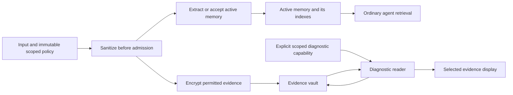

# PRME engine evidence privacy architecture

Tracking epic: [dwamianm/prism#318](https://github.com/dwamianm/prism/issues/318).

Proposed 2026-10-19. This is a target design, not current functionality.
[RFC-0019](../../RFC-0019-Evidence-Privacy.md) now freezes the v1 contract,
including the [copy inventory](content-copy-inventory.json),
[sanitizer registry](sanitizer-contract.json) and [scenario manifest](privacy-scenarios.json).
The RFC takes precedence over the early sketches below where it selects a
library, state name or versioned contract. Runtime implementation remains pending.
[Engine requirements and issues](README.md) belong to `dwamianm/prism`.
The engine provides reusable local policy, sanitization, storage and erasure
capabilities without depending on hosted organizations, project tables or AWS.
The [hosted architecture](https://github.com/dwamianm/prism-monorepo/blob/main/memory-bank/plans/2026-10-evidence-privacy/architecture.md) consumes these interfaces
and owns project settings, authentication, cloud key services and scheduling.

## What the vault idea can enforce

Encrypting evidence by default is feasible. Making ordinary memory credentials
unable to decrypt an evidence archive is also feasible. Cryptography cannot
determine whether an authorized person is really troubleshooting, prevent that
person from copying revealed text, or make already disclosed information secret
again when a session expires.

| Approach                                              | Protection                                                                    | Limitation                                                                                    | Recommendation                            |
| ----------------------------------------------------- | ----------------------------------------------------------------------------- | --------------------------------------------------------------------------------------------- | ----------------------------------------- |
| Encrypt the database/pack                             | Protects stolen storage when the key is absent                                | The running application can read the data; does not enforce diagnostic-only use               | Baseline protection for the whole store   |
| Separate encrypted evidence and decrypt authorization | Restricts which running components and identities can reveal retained sources | The input processor sees new plaintext; key administrators can change policy                  | Implement for the optional sealed profile |
| Client-held evidence keys with client-side extraction | Can keep raw evidence from the hosted service                                 | Recovery, devices, ingestion and support all change; derived facts still disclose information | Separate future epic                      |

1Password's model places decryption keys with the user and uses end-to-end
encryption. Borrowing its unlock interaction does not confer that same boundary
on a hosted extractor. [1Password security model](https://support.1password.com/1password-security/)

## Current integration points

These repository findings explain why adding one encrypted column is insufficient:

| Surface                       | Current evidence                                                                                                        | Required treatment                                                                                          |
| ----------------------------- | ----------------------------------------------------------------------------------------------------------------------- | ----------------------------------------------------------------------------------------------------------- |
| Source events                 | `src/prme/storage/event_store.py` and `storage/pg/event_store.py` store content and hashes                              | Separate public event envelope from protected payload; permission-aware source reads                        |
| Claims and notes              | `documentation/configuration.md` describes source sentences in claim text and longer `evidence_quote` passages          | Explicitly admitted memory representation, separate evidence reference, no raw-note fallback in sealed mode |
| Derivation and retry journals | `models/derivation.py` contains node snapshots and prepared embedding/lexical content; extraction records preserve work | Split executable admitted-memory plans from protected sanitized processing work                             |
| Retrieval receipts            | `models/relevance.py` stores the query, configuration, candidate hashes and execution metadata                          | Classify query text and execution payloads; redact or protect text, keep a versioned metadata-only receipt  |
| Lifecycle/organizer records   | RFC-0007's implemented TTL path retains complete before/after snapshots                                                 | Privacy policy also applies to snapshots, summaries, profiles and retired records                           |
| Indexes and staging           | USearch/Tantivy or pgvector/full text, plus prepared/staged content                                                     | Index only admitted memory in sealed mode; delete derivatives, not only event rows                          |
| Encryption                    | `documentation/deployment.md` distinguishes decrypted-open directory packs and native encrypted single-file packs       | Require protected storage before writing; keep evidence keys separate from ordinary storage keys            |

The implementation inventory must additionally cover API/MCP responses, graph
inspection, chat-history adapters, user metadata, debug logging, error bodies,
telemetry, WAL/temp files, exports, backups and the engine's memory explorer.
Existing data must be checked during migration; changed defaults protect only
new data unless older copies are actually transformed or erased.

## Data classes and profiles

1. **Admitted memory:** facts, preferences, decisions and necessary qualifiers
   deliberately retained for normal agent use. These remain private application
   data and may contain the same fact that appears in a source. Encrypting source
   evidence does not hide that fact from a credential allowed to read memory.
2. **Evidence payload:** a minimal supporting excerpt or explicitly retained full
   sanitized source, plus sanitized diagnostic attachments. Pre-sanitization
   originals are not retained in v1. Never assume that a summary,
   embedding or hash anonymizes the information from which it was produced.
3. **Provenance envelope:** opaque record IDs, owner/scope bindings, source class,
   clocks, policy version and availability state. Avoid personal names in public
   IDs. Even these metadata have access and retention policies.
4. **Processing work:** temporary sanitized input needed for accepted asynchronous
   extraction. It uses a different encryption purpose and access policy from
   retained diagnostic evidence and has a finite retry deadline.
5. **Audit record:** actor ID, opaque target IDs, action, policy version, outcome,
   timestamps and fixed reason code. No plaintext, keys, raw prompts, user-entered
   secrets or full before/after source snapshots.

Proposed policy fields are `evidence_capture = none | minimal | full`,
`evidence_use = runtime | diagnostics_only`, `evidence_expires_at`,
`memory_erase_after` (including an explicit `until_deleted`), and a versioned
admission policy. These are contract sketches, not final API names.

The standard profile permits runtime use of sanitized sources and protects retained evidence
at rest. The sealed profile requires `diagnostics_only` and separates admitted
memory from source passages. The no-evidence choice keeps no diagnostic source
payload after processing. Changing policy to a stricter profile is a migration,
not a flag that makes existing copies disappear.

In the target contract, `store()` explicitly admits caller-provided memory text and passes through
the same sanitizer as `ingest()`; direct storage is not a bypass. `ingest()` can
extract a compact fact, but the extractor is fallible; schema/qualifier checks,
caller exclusions and source-only leakage tests are required. A memory
intentionally containing a permitted sensitive fact remains sensitive in every
profile. Do not describe sealed mode as hiding everything in a message.

Minimal excerpts must preserve conditions, negations and speaker attribution.
If a safe excerpt cannot be produced within a configured limit, do not cut off a
qualifier to fit: reject that evidence capture or request an explicit full-source
policy. A model detector is not authorization to retain more data.

## Automatic sanitization before admission

Both retrieval profiles use a shared versioned sanitizer, before any content
storage, embedding or external extraction. First apply mandatory supported
credential recognizers; detected credentials block admission in the hosted
baseline. Then apply project-selected category rules, bounded custom exclusions,
and a maintained local entity-recognition component. Do not send unsanitized
input to an external model to decide what should have been removed.

RFC-0019 selects the local Presidio adapter, exact package/model versions and
English-only allowlisted registry for PV-13. It remains a fallible component,
not a complete security boundary. Its rule-based and entity-based recognizers
can miss sensitive information. The frozen matrix is in
[sanitizer-contract.json](sanitizer-contract.json).
[Presidio documentation](https://presidio.dataprivacystack.org/)

V1 category actions are `allow`, `redact`, `pseudonymize`, or `block`, within an
explicit supported category/action matrix. `allow` is unavailable for the platform's
mandatory prohibited categories. Balanced is the recommended initial preset;
strict adds a constrained memory schema and supported value validators. Custom
overrides cannot disable the mandatory baseline. A project may disable optional
categories by choosing `allow`, with a visible statement that those values remain
in normal memory. No preset is named anonymous or leak-proof.

The mandatory baseline is still fallible: it guarantees enforcement of configured
rules and supported fixtures, not detection of every possible secret. A disguised
password, an unfamiliar language or a confidential business plan can be missed.
Unsupported language/detector configurations, detector errors and timeouts reject
admission; those checks do not guarantee correct automatic language detection.
User-configured rules are bounded and declarative, use safe matching, and cannot
execute arbitrary code or make unrestricted network calls.

Irreversible removal is the default for detected direct contact identifiers.
Optional stable placeholders preserve useful relationships within one project,
owner and scope. The same input in another boundary gets a different identity.
Use a reviewed keyed lookup or protected mapping; no plain unsalted identity
hash, global cross-project token or plaintext reverse map. Reversible identity
recovery is out of scope for v1. Mapping state, if used internally, inherits the
same access/erasure rules, and losing it must not silently merge people. Reserve
and escape the placeholder syntax so a source cannot impersonate an issued token.
Stable placeholders are pseudonyms; surrounding facts can still identify a person.

For example, a source saying an email address and a meeting-time preference can
retain the preference with `[EMAIL_REMOVED]` replacing the address. Preserve
conditions, negations, speaker relationships and time qualifiers. If transformation
makes a claim ambiguous, reject that claim or the input according to policy; do not
guess its meaning. A strict memory schema admits only named fields and validated
values, not arbitrary free text hidden inside an allowed `notes` field.

The sanitized text becomes the authoritative source for new extraction and verbatim
evidence checks. Record its own ID/checksum, sanitizer/policy versions, availability
and non-content transformation counts. Label quotations as sanitized. Do not call
them original quotations, retain deleted spans in a report, or retain a public
hash of predictable removed values. Legacy events keep their identity; migration
creates a new representation and handles the old payload explicitly.

Cover all text entry points: sync/async `store`, ingest, fast/batch admission,
HTTP/MCP, framework history and supported import paths. Apply the policy to
content-bearing metadata and display names as well as body text; authenticated
opaque identity fields remain validated protocol data. Sanitized user queries
are the only queries persisted or sent to external retrieval components. Validate
generated extraction/organizer text before persistence too, preventing an output
adapter from bypassing admission rules.

API gateways, application logs, error handlers, tracing and preview endpoints must
not save raw bodies before the sanitizer executes. Accepted queues, indexes,
journals, diagnostics and backups contain only sanitized representations. Plaintext
originals still exist transiently in the receiving process; client-side sanitization
can reduce that exposure but is not required or claimed by the hosted v1 design.
Visual input remains rejected in protected v1 profiles.

Existing copies need re-sanitization and erasure under PV-06/PV-07; a new config
value does not clean historical claims, embeddings, snapshots or exports. When
the original needed for rematerialization is unavailable, withhold or erase the
affected derivative and report that limitation. Never reconstruct removed text
to restore a previous quality score. Output checks and restricted agent tools
remain additional defenses, not substitutes for admission or authorization.
[OWASP prompt-injection guidance](https://cheatsheetseries.owasp.org/cheatsheets/LLM_Prompt_Injection_Prevention_Cheat_Sheet.html)

## Ingestion and retrieval flow

The diagram describes sealed mode. Standard mode deliberately has an additional,
authorized runtime source-read path and must not display a sealed status.

At ingestion, evaluate policy and sanitize before writing content to application
logs, queues, source events or extraction records, and before embedding or a
provider call. Only the sanitized representation reaches these paths in v1.
The consuming application discloses the configured provider boundary; encryption after extraction
cannot undo a prior transmission. The no-evidence mode still creates admitted
memory, not a promise that nothing is stored anywhere.

Synchronous ingestion handles original plaintext transiently, sanitizes it, and
encrypts retained sanitized evidence before durable storage. Asynchronous ingestion
also sanitizes before enqueueing and needs a protected work queue. A
dedicated extraction worker may decrypt only currently pending work it owns, never
the completed evidence archive. The default proposed retry deadline is 24 hours
and never exceeds the applicable source policy. Erase the work payload on success,
expiry, cancellation or source deletion. A strict no-durable-input policy requires
synchronous processing and caller resubmission after failure.

After extraction, save an admitted-memory derivation plan that can commit and
recover without decrypting evidence. Any accompanying diagnostic response/quote
must pass sanitization and belongs in protected storage. Expiry, erasure or a
stricter policy wins over a pending retry. Restart must
not recreate expired evidence from an earlier journal or processing queue.

In sealed mode, ranking and packing operate only on admitted memory and approved
metadata. No raw-note indexing, silent evidence decryption, source fallback,
automatic evidence-to-model disclosure or decrypted-source cache is allowed.
When a query requires an unavailable source, report that limitation. Exact source
quotations and source-grounded debugging require the diagnostic workflow.

## Encryption and key custody

Use an established authenticated-encryption implementation, such as AES-256-GCM
through a maintained library. Generate a random data-encryption key per evidence
object and fresh nonces according to the library's contract. Store only ciphertext,
the wrapped data key, non-secret key/version identifiers and the envelope. Bind
record ID, tenant/owner/scope, purpose and schema version as authenticated data so
moving ciphertext between records cannot grant access. Do not invent a cipher or
derive record keys from predictable source text. [OWASP storage guidance](https://cheatsheetseries.owasp.org/cheatsheets/Cryptographic_Storage_Cheat_Sheet.html)

Separate wrapping keys and permissions for `processing`, `evidence`, and ordinary
store encryption. Per-object data keys allow selective rotation/re-encryption;
they do not by themselves guarantee selective cryptographic erasure from backups.
Use opaque, non-sensitive IDs in associated context, because provider audit
logs may retain it. Provider-specific key adapters live in the consuming service.

For local operation, separate the write capability from the private diagnostic
unlock capability using a maintained public-key/envelope facility or an external
key provider. Provision the private capability in an OS key store or external
secret manager, outside the pack and ordinary retrieval process. A sealed pack
with the decrypting key permanently loaded in the same Python process is not an
enforced service boundary and must be labeled accordingly. The API must reject
claims of process isolation in that configuration. Same-user malware or an
administrator may still bypass local OS protections; disclose this boundary.

Key recovery is explicit. A local user exports a recovery key only through a
separate deliberate operation and keeps it apart from the encrypted pack. No
automatic recovery key in a pack/export, no hidden universal support key, no
silent plaintext downgrade. Lost unrecoverable evidence keys mean lost evidence;
admitted memories can remain usable under their separate storage protection.
Hosted operators implement custody in the [separate hosted design](https://github.com/dwamianm/prism-monorepo/blob/main/memory-bank/plans/2026-10-evidence-privacy/architecture.md).

## Local diagnostic capability

The engine accepts an explicit scoped, expiring evidence-read capability through
a dedicated diagnostic API/CLI. It validates owner/scope, selected record IDs,
current policy, expiry/erasure fences and the audit sink before disclosure. Missing
capability, required audit sink or key denies the read. Ordinary retrieval does not
mint capabilities or load diagnostic decryption keys automatically.

The CLI makes unlocking deliberate and uses the chosen external key provider or
local protected key store. Applications supply their authentication and capability
issuer; the engine does not define hosted accounts or organization roles. A local
operator controlling the process can bypass application checks; scoped APIs alone
do not establish a hostile-process security boundary.

Record access attempts and successful authorization without content. Never export
recovery keys inside a pack or place diagnostic plaintext in routine logs. Explicit
local unlocks have selected records and a finite lifetime. Already displayed/copied
text cannot be revoked, and heap zeroization is not guaranteed.

Hosted session reauthentication, 10-minute/20-record ceilings, broker identity and
UI locking are specified in the separate hosted architecture.

## Expiry, erasure, and immutability

Evidence expiry removes the retained source payload and copies, while admitted
facts remain until their own erasure policy says otherwise. A request to forget
a fact/person/source is different: resolve the affected memory records and
derivatives and erase or invalidate those too. A source-only operation must say
clearly that learned facts remain.

The transaction establishing an erasure fence is the acknowledgment boundary.
After it commits, new reads are denied and old workers cannot publish a deleted
source's content. Already delivered responses cannot be recalled. In-flight
responses must revalidate before disclosure. Purge is durable, idempotent and
resumable, covering evidence/work payloads, graph contents, summaries/profiles,
lexical/vector entries, staging, receipts and text-bearing operation records.

For a multi-source fact, retain only what can be justified from surviving,
available sources or explicit caller admission. If safe separation is uncertain,
invalidate the whole affected derivative. Never silently preserve a sensitive
passage because another source also links to its summary. Shared owner/scope
boundaries still apply.

Amend the append-only contract explicitly: event identity and a minimal erasure
record remain, but policy-authorized content and content-bearing historical
snapshots may be removed. The erasure record must not contain the deleted text,
full before/after nodes, or a public unsalted hash of predictable sensitive text.
Retained commitments, if needed, use a reviewed keyed design and inherit access
and retention rules. Historical checksums are not rewritten and presented as the
original record: report unavailable/redacted payloads with a new schema/version.

Expose states such as `requested`, `blocked_from_access`, `live_purged`,
`backup_expiry_pending`, and `complete_within_managed_boundary`. Never report
physical-media sanitization merely because SQL rows or a wrapped key row vanished.

Backups may retain ciphertext, pre-migration plaintext, wrapped keys and journals.
Deleting a live wrapped key does not erase a backup copy if its wrapping key still
works. Supported restore/import accepts a current erasure ledger and applies it
before serving; a snapshot alone cannot prove deletion continuity. The hosted
service owns its independent ledger service and managed backup lifecycle.

Local portable copies have no central revocation. The operator must erase or
sanitize their copies and supply a current ledger for supported restore. Report
that limit; do not claim arbitrary offline copies were remotely deleted.

This changes rebuild guarantees. Indexes can rebuild from surviving admitted
memory. Re-extracting erased sources cannot be supported, and exact replay may be
unavailable. A missing source is a declared state, never an invitation to recover
it from an overlooked journal.

## Threat model and residual risk

| Threat                                      | Intended mitigation                                     | Remaining boundary                                                                                 |
| ------------------------------------------- | ------------------------------------------------------- | -------------------------------------------------------------------------------------------------- |
| Stolen pack/database snapshot               | Encrypted payloads; keys outside data                   | Active-memory confidentiality also needs whole-store protection; old backups may predate migration |
| Compromised ordinary agent/API credential   | No sealed-source read or grant permissions              | Credential can still read admitted memory within its normal scope                                  |
| Prompt injection requesting raw history     | No evidence-decrypt capability exposed to agent         | Sensitive admitted facts still require ordinary authorization and minimization                     |
| Tenant/record substitution                  | Owner checks plus authenticated context binding         | Deployment key administrators can change permissions                                               |
| Compromised ingestion worker                | Work-purpose isolation and finite work lifetime         | Ingress sees original plaintext transiently; extraction sees sanitized work it may decrypt         |
| Insider diagnostic access                   | Explicit scoped diagnostic capability and audited reads | Authorized humans can copy text; platform administrators retain control of the platform            |
| Restore or retry resurrects deleted content | Durable fences and independent erasure ledger           | Customer-held copies and third-party provider retention are outside product control                |

## Quality and release boundaries

A byte-preserving storage-encryption change must not alter ranking/packing on
fixed standard-profile fixtures before expiry. Sealed mode changes both admission
and retrieval and must be evaluated as its own configuration. It may lose exact
quotes, chronology or multi-hop answers that depend on omitted text. Show the loss;
do not defeat the privacy policy to meet a benchmark.

PV-11 defines a finite synthetic and saved-fixture gate. Any change to universal
retrieval defaults must additionally follow the engine's required default-change
evaluation policy under a separately approved budget. A successful privacy gate
does not substitute for that requirement, and a good answer score never excuses
source leakage.
